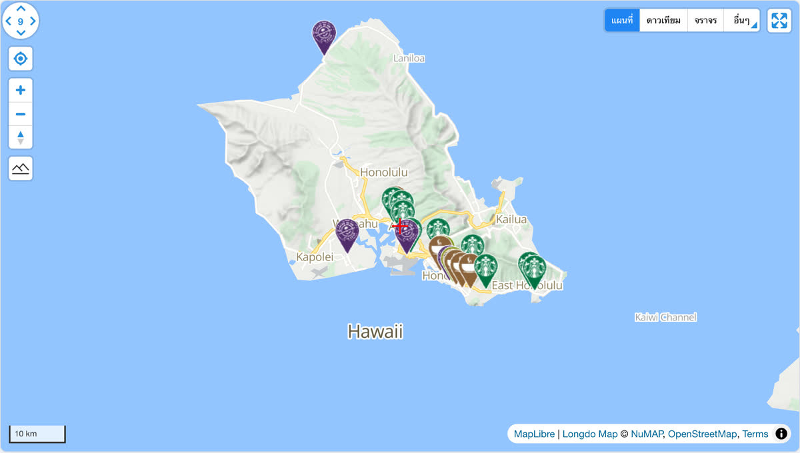

# @mapconductor/reactnative-for-longdo

MapConductor の Longdo Map 用 React Native プロバイダーです。Web 用の
`@mapconductor/react-for-longdo` とは別パッケージで、Android の
`com.mapconductor:for-longdo` と iOS の `MapConductorForLongdo` を薄くラップします。

## デモ

[](https://demo-react.mapconductor.com/longdo/map/en)

画像は Web 版（[`@mapconductor/react-for-longdo`](https://github.com/MapConductor/react-for-longdo)）の[ライブデモ](https://demo-react.mapconductor.com/longdo/map/en)です。同じ店舗マップを React Native で書くと次のとおりです。

```tsx
import { useMemo, useState } from 'react';
import { Text } from 'react-native';
import {
  createGeoPoint,
  createMapCameraPosition,
  createMarkerState,
  type MarkerState,
} from '@mapconductor/js-sdk-core';
import { InfoBubble, Markers } from '@mapconductor/js-sdk-react/native';
import { LongdoDesign, LongdoMapView, useLongdoViewState } from '@mapconductor/reactnative-for-longdo';

const STORES = [
  { id: 'waikiki', name: 'Waikiki', latitude: 21.2793, longitude: -157.8292 },
  { id: 'kailua', name: 'Kailua', latitude: 21.3972, longitude: -157.7394 },
  { id: 'haleiwa', name: 'Haleiwa', latitude: 21.5928, longitude: -158.1034 },
];

const INITIAL_CAMERA = createMapCameraPosition({
  position: createGeoPoint({ latitude: 21.38, longitude: -157.93 }),
  zoom: 10,
});

export function StoreMap() {
  const mapViewState = useLongdoViewState({
    mapDesignType: LongdoDesign.Normal,
    cameraPosition: INITIAL_CAMERA,
  });
  const [selected, setSelected] = useState<MarkerState | null>(null);
  const markers = useMemo(
    () =>
      STORES.map(store =>
        createMarkerState({
          id: store.id,
          position: createGeoPoint({ latitude: store.latitude, longitude: store.longitude }),
          extra: store,
          onClick: marker => setSelected(marker),
        }),
      ),
    [],
  );

  return (
    <LongdoMapView state={mapViewState} style={{ flex: 1 }} onMapClick={() => setSelected(null)}>
      <Markers states={markers} />
      {selected && (
        <InfoBubble marker={selected}>
          <Text>{(selected.extra as (typeof STORES)[number]).name}</Text>
        </InfoBubble>
      )}
    </LongdoMapView>
  );
}
```

## 使い方

```tsx
import {
  LongdoDesign,
  LongdoMapView,
  useLongdoViewState,
} from '@mapconductor/reactnative-for-longdo';

export function MapPage() {
  const state = useLongdoViewState({
    id: 'main-map',
    mapDesignType: LongdoDesign.Normal,
  });

  return <LongdoMapView state={state} style={{ flex: 1 }} />;
}
```

通常のオーバーレイは `@mapconductor/js-sdk-react` の `Marker`、`Markers`、
`Polyline`、`Polygon`、`Circle`、`GroundImage`、`RasterLayer` を子として宣言します。
大量のマーカーには、1 マーカーごとの React effect を作らない `Markers` を使用してください。

## ネイティブ設定

- Android: MavenLocal の `com.mapconductor:for-longdo:1.2.0` と Longdo の Maven
  リポジトリが必要です。API キーは application manifest の `longdo.map.key` へ設定します。
- iOS: `MapConductorForLongdo` を CocoaPods で解決します。API キーは Info.plist の
  `LONGDO_API_KEY` へ設定します。

キーは環境変数、Gradle property、または git 管理外の設定ファイルから注入し、
リポジトリへコミットしないでください。

## 開発時の確認

```bash
npm run build --workspace @mapconductor/reactnative-for-longdo

env JAVA_HOME="/Applications/Android Studio.app/Contents/jbr/Contents/Home" \
  ./gradlew :android:app:compileDebugKotlin
```

Longdo は WebView 内の MapLibre renderer を使いますが、クリックのカスケードと座標投影は
各ネイティブドライバー側の責務です。RN 層で別の当たり判定や page-level の map-ready
ゲートを追加しないでください。
